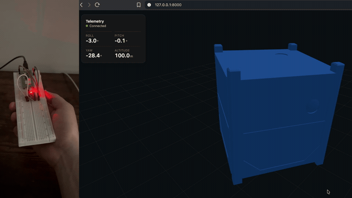
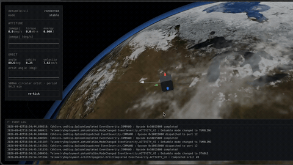

# F´ Labs

Repository ("Lab") for Flight Software and Embedded Systems projects.

The foundation for the projects within this repository is the Official NASA F´ Software (https://github.com/nasa/fprime).

The intention here is to create amazing projects anyone in the Aerospace Industry can use, based on reliable standards and useful ideas.

Each project is independent from each other, meaning that there's no 'inter-project' dependencies to run each of them.

## Projects

- **[getting-started/](getting-started/)** The official F´ 'Hello World' project (`FprimeGettingstarted`) scaffolded from the F´ bootstrap tool, used to learn the framework. Contains a single example `HiComponent` and a `FirstDeployment` topology.

- **[imu-altitude-visualization/](imu-altitude-visualization/)** IMU telemetry pipeline with live 3D visualization. An `ImuReader`/`ImuSim` F´ component (`ImuAltitudeVisualization` deployment) ingests IMU data (from Pico firmware in `firmware/pico-imu`, or a simulator), a Python `bridge/telemetry_bridge.py` relays telemetry from F´ GDS to a WebSocket, and a three.js page in `visualization/` renders it live in the browser.

  

- **[detumble-sil/](detumble-sil/)** ADCS demo, entirely in F´, no hardware. `DetumbleSim` simulates a tumbling rigid body under a rate-damping control torque, closing the loop every cycle (`KICK` re-tumbles it on demand); `OrbitPropagator` independently propagates a circular Kepler orbit, radius/period derived at runtime. The same telemetry-bridge + three.js pattern as `imu-altitude-visualization` renders a real CubeSat STL live in the browser, orbiting a to-scale Earth, with rolling analytics charts.

  

- **[iss-tracker/](iss-tracker/)** Mount that points a stick at the International Space Station in real time. `Sgp4Propagator` propagates the ISS from a CelesTrak TLE with SGP4 and computes its azimuth and elevation for the observer, checked against Skyfield in the unit tests. `AntennaController` turns them into mount commands within the mount's limits, and `PicoLink` sends them over USB serial to a Raspberry Pi Pico 2 W (`firmware/pico-tracker`) that drives a stepper (azimuth) and a servo (elevation). A simulated pass test replays a real ISS pass for a virtual observer through the same components.
